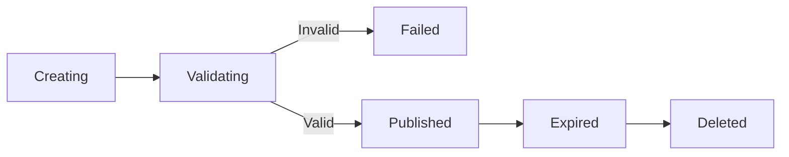

# Backup and restore conventions

## Scope

Backups protect the persistent corpus state required to serve the system after
restart or recovery.

### Included components

- Metadata store:
  - Document identities and versions.
  - Corpus versions.
  - Chunks, provenance, source locations, and lineage.
  - Schema and migration state.
- Persistent indexes:
  - Lexical index.
  - Dense-vector index.
  - Metadata and filter indexes.
  - Structured-fact and summary indexes when they become persistent.
- Recovery manifest:
  - Corpus version.
  - Schema and index format versions.
  - Component inventory.
  - Creation time.
  - Integrity information, such as checksums.

The manifest identifies the metadata store and indexes as one recoverable
corpus state rather than as independent files.

### Excluded components

- Original documents.
- Models.
- Temporary caches.
- Logs and profiling output.
- Other reproducible operational artifacts.

Original documents require a separate source-data backup or availability
policy. A restore is not operationally complete unless cited source files are
also available through that policy.

## Consistency boundary

Each backup represents one immutable corpus version. The metadata store is
authoritative for the corpus version, and every included persistent index must
identify the same corpus version and index generation.

### Backup coordination

- Coordinate backup creation with ingest so no corpus-version commit occurs
  during snapshot capture.
- Ensure all indexes for the selected corpus version are committed and durable
  before capture completes.
- Permit read-only queries to continue during backup creation.
- Finalize a backup only after all components are captured, validated, and
  recorded in the manifest.

### Invalid backups

The system must not present a backup as restorable when it is:

- Incomplete or interrupted.
- Missing a required component.
- Composed of mixed corpus versions or index generations.
- Inconsistent with its manifest.
- Not validated successfully.

## Backup forms

The backup strategy distinguishes portability from fast compatible recovery.

### Portable backup

The portable backup is the baseline backup contract. It must be restorable on
another compatible machine without depending on local absolute paths, storage
snapshots, GPU availability, or memory-mapped addresses.

It contains:

- A logical export of the metadata store.
- Canonical chunks, provenance, and other records required to rebuild indexes.
- Index configuration and generation metadata.
- A manifest, schema version, and checksums.
- Serialized indexes only when their format is documented and portable.

Portable backups support fixture reproduction, cross-machine testing, and
recovery after index-format changes. Indexes may be rebuilt from the canonical
records when a portable serialized index is unavailable or incompatible.

### Recovery snapshot

A recovery snapshot is optimized for fast restore on compatible software and
storage. It may use database-native backups, index-native snapshots, or
storage-level copy-on-write snapshots, provided that the same corpus-version
boundary and manifest rules apply.

Recovery snapshots may depend on a particular index format, software version,
filesystem, or storage platform. They are an optimization and must not replace
the portable backup contract.

## Compatibility and migration

Every backup must record the versions required to determine whether it can be
restored by the current software.

### Metadata schema

The manifest must include:

- Metadata schema version.
- Migration version.
- Application version that created the backup.

Restore may apply supported forward migrations, but must never silently
downgrade a newer schema. A backup from a newer unsupported schema must be
rejected before active data is changed. Applied migrations must be recorded.

### Index formats

Each persistent index must record:

- Index format version.
- Index implementation.
- Index library version.
- Relevant build and configuration parameters.

The restore process must:

- Restore directly when the index format is supported.
- Apply a documented conversion when one exists.
- Rebuild from canonical records when the format is incompatible but safe
  source records are available.
- Reject the backup when direct restore, conversion, and rebuild are not safe.

Portable backups include canonical chunks and provenance so that indexes can
be rebuilt when their serialized formats are incompatible.

### Backups from newer builds

Backups created by a newer application version must not be restored on a
current version unless the manifest explicitly indicates compatibility. The
system must compare schema, migration, and index versions and reject
unsupported combinations before modifying active data.

### Model versions

Model versions are recorded for reproducibility, but do not automatically make
the complete backup invalid.

- Embedding model identity, revision, dimensions, preprocessing, and distance
  metric are required for dense-index compatibility.
- Reranker and generator versions are recorded but normally do not block index
  restore.
- Extraction and summary model versions are recorded and may require
  invalidation or recomputation of their derived outputs.
- A changed embedding model requires a dense-index rebuild or a separately
  maintained compatible index.

Restore is permitted only when the metadata schema and every included index are
compatible, migratable, or safely rebuildable from canonical records.

### Source-data backup

Original documents are managed by a separate source-data backup or availability
policy. This separation keeps the corpus-state backup smaller while preserving
a clear responsibility for citation source files.

Test fixtures may include original documents in a separate source-data bundle
so that portable restore tests can verify citation navigation as well as
metadata and index recovery.

## Configuration

Backup settings are deployment-specific and belong under the existing
`[storage]` configuration section. They use the project-wide precedence order:

1. Explicit `Settings(...)` values.
2. Environment variables.
3. Values in `config.toml`.

### Settings

The initial settings are:

| Setting | TOML field | Environment override | Policy |
| --- | --- | --- | --- |
| Backup destination | `storage.backup_dir` | `STORAGE__BACKUP_DIR` | Required when backup operations are enabled; must be a local path separate from active storage. |
| Restore staging directory | `storage.restore_staging_dir` | `STORAGE__RESTORE_STAGING_DIR` | Required when restore operations are enabled; must not be the active index directory. |
| Retained generations | `storage.backup_retention_count` | `STORAGE__BACKUP_RETENTION_COUNT` | Defaults to `5`; must retain at least one known-good backup. |
| Compression | `storage.backup_compression` | `STORAGE__BACKUP_COMPRESSION` | Defaults to `none`; the selected format must be recorded in the manifest. |
| Automatic backups | `storage.automatic_backup_enabled` | `STORAGE__AUTOMATIC_BACKUP_ENABLED` | Defaults to `false`; explicit backup operations are the initial baseline. |

Paths must be validated as `Path` values. The loader need not require them to
exist, but backup and restore operations must report clear errors when a path
cannot be created, accessed, or has insufficient space.

### Validation policy

- Manifest, checksum, version, and component validation is always required
  before publication.
- Restore validation is always required before activation.
- Optional deep validation may be configurable if it is measurably expensive.
- Configuration must not disable safety-critical validation.
- Automatic scheduling is an optional extension and is disabled initially.

Each setting requires a typed field, documented TOML location and environment
override, explicit default or required-value policy, appropriate validation,
and tests for loading, precedence, conversion, missing values, and invalid
values.

## Backup lifecycle

The initial lifecycle uses immutable, generation-based full backups.

### Lifecycle stages

Backups progress through explicit states:

Failed creation or validation must result in `failed`, not `published`.
Only published backups may be selected for restore. Expiration records that a
backup is outside the retention policy; deletion is a separate operation.

### Creation and publication

- Create a full portable backup at a defined corpus-version boundary.
- Validate every component and the complete manifest.
- Publish the backup atomically only after validation succeeds.
- Optionally create a compatible recovery snapshot for faster local restore.
- Keep published backups immutable.

### Retention and deletion

- Retain multiple generations according to a documented policy.
- Do not delete the last known-good backup.
- Treat pruning as a separate, conservative operation.
- Periodically validate retained backups and perform restore drills in a clean
  location.

Full portable backups are the initial baseline because they provide
reproducible fixtures, straightforward restore, and cross-machine testing.
Incremental backups are in scope as future work if measurements show that full
backups require excessive time or storage.

## Restore behavior

Restoration must be staged, validated, and non-destructive. The active
installation must remain unchanged until the complete restored state is ready
to activate.

### Restore sequence

1. Select a published backup.
2. Validate its manifest, checksums, corpus version, schema version, and
   component compatibility.
3. Confirm that the required source documents are available through the
   separate source-data policy.
4. Restore the backup into a new staging location.
5. Open and validate the metadata store and every included index.
6. Run smoke checks for metadata queries, index queries, provenance, and source
   spans.
7. Create a pre-restore backup when replacing an existing installation.
8. Atomically activate the validated staged restore.
9. Restart or reconnect serving components and run post-activation checks.

### Restore outcomes

- `validated`: the backup is usable but not active.
- `activated`: the restored state is serving.
- `rejected`: validation failed and the active state is unchanged.
- `rolled_back`: activation or post-activation checks failed and the previous
  state was restored.

### Restore forms

Portable backups may require index rebuilding when serialized indexes are
unavailable or incompatible. The restore must report when reconstruction
occurred.

Recovery snapshots should provide faster restore on compatible software and
storage, but must still pass manifest, checksum, compatibility, and smoke
validation before activation.

Exact commands, service controls, deployment paths, troubleshooting, and
restore-drill procedures belong in an operator-facing runbook.

## Verification criteria

The following scenarios define the acceptance criteria for the eventual
implementation. They should be implemented as deterministic tests when the
metadata store, persistent indexes, and backup interfaces are available.

| Scenario | Expected result |
| --- | --- |
| Valid deterministic fixture backup and restore | Restores successfully with the expected corpus state. |
| Checksum or manifest mismatch | Backup is rejected and the active state is unchanged. |
| Interrupted backup or restore | No partial state is published or activated. |
| Corrupt or incomplete backup | Restore is rejected before active data changes. |
| Schema or index-version incompatibility | Restore is migrated, rebuilt, or rejected according to the compatibility policy. |
| Restore into an empty data directory | The restored system serves expected metadata and index results. |
| Restore over an active installation | A pre-restore backup is created and activation is atomic. |
| Concurrent reads during backup | Queries remain safe and return a consistent corpus state. |
| Ingest during backup | The backup captures one corpus version and does not mix generations. |
| Restart after restore | The corpus serves without reconstructing unchanged data. |
| Privacy-safe logging | Logs contain required operational fields without sensitive content. |
| Disk-space and retention edge cases | Operations fail safely and retain the last known-good backup. |

Restore drills should also verify source-document availability and citation
navigation using a separate source-data fixture.

## Failure handling

Backup and restore operations must fail closed. An incomplete, unvalidated, or
incompatible backup must never become an active or published recovery point.

### Backup failures

- Any creation or validation failure produces an unpublished backup.
- The previous published backup remains available and unchanged.
- Mixed corpus versions, missing components, checksum failures, and
  compatibility failures are hard failures.
- Failed or interrupted work is staged or quarantined until it can be safely
  removed.

### Restore failures

- Restore into a separate staging location.
- Validate the complete restored state before activation.
- Leave the active installation untouched if restore or validation fails.
- Create a pre-restore backup before replacing an existing installation.
- Preserve a known-good recovery point throughout the operation.

### Retries and cleanup

- Retries must be idempotent and must not publish partial state or create
  conflicting backup identities.
- Cleanup must not remove the last known-good backup, a published backup, or a
  backup currently selected for restore.
- Failed operations must report whether recovery remains available from the
  last known-good backup.

## Logging and privacy

Backup and restore operations must use structured, privacy-safe logs. Logs must
provide operational visibility without exposing corpus or user payloads.

### Required fields

Every record must include:

- `timestamp`.
- `level`.
- `event`.
- `module`.
- `pipeline_stage`.
- `document_id`, or `null` when not applicable.
- `corpus_version`, or `null` when not applicable.

Backup operations may also include the backup identity, component name,
component count, bytes processed, duration, validation result, retry number,
failure category, and whether recovery remains available. Use backup IDs and
component names for correlation; do not include sensitive absolute paths.

### Events

Event names must be stable, machine-readable, and use snake case. Backup and
restore events include:

- `backup_started`.
- `backup_component_completed`.
- `backup_validated`.
- `backup_published`.
- `backup_failed`.
- `restore_started`.
- `restore_component_validated`.
- `restore_validated`.
- `restore_activated`.
- `restore_rolled_back`.
- `restore_failed`.
- `backup_prune_completed`.

### Log levels

- `INFO`: Successful lifecycle milestones, validation, publication, activation,
  and normal completion.
- `WARNING`: Recoverable retries, lock contention, temporary degradation, or
  cleanup requiring attention.
- `ERROR`: Failed backup, restore, validation, activation, or pruning work.
- `CRITICAL`: Process-wide conditions that make continued operation unsafe.

### Prohibited content

Logs must not contain:

- Document text or source passages.
- User queries, prompts, or model outputs.
- Credentials or secrets.
- Confidential document names or identifiers unless explicitly approved.
- Absolute or sensitive storage paths.
- Backup contents.
- Unredacted exception data that may contain payloads.

Manifest metadata such as versions, sizes, component names, and checksums may
be recorded selectively, but the complete manifest must not be dumped into the
logs.
